# 🔷 NodeSnap

**🌍 Language:** [🇫🇷 Français](README.md) · **🇬🇧 English**

🛡️ Multi-vendor network device configuration backup tool. 📸 Stores snapshots in SQLite, detects changes, and exposes a 🌐 web interface along with a 🔌 REST API.

## 📸 Screenshots

> Interface available in **5 themes**: Dark, Light, Dracula, Tokyo Night, Cyberpunk — select from the dropdown in the navigation bar.

### Dashboard

<table>
<tr>
<td align="center"><b>🌑 Dark</b></td>
<td align="center"><b>☀️ Light</b></td>
</tr>
<tr>
<td>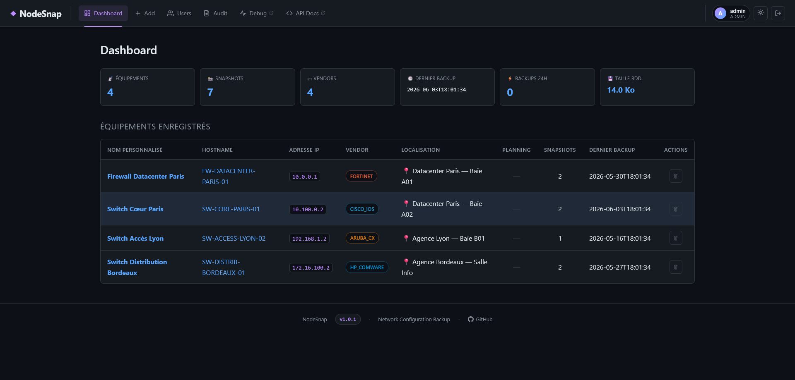</td>
<td>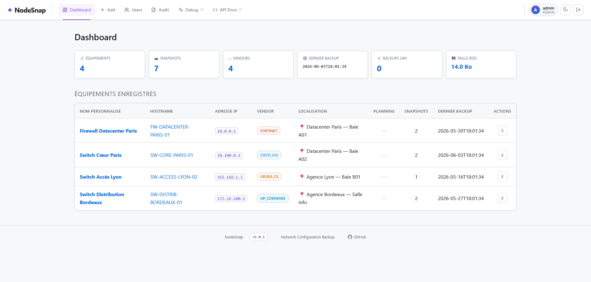</td>
</tr>
</table>

Overview: counters (devices, snapshots, vendors, DB size), registered devices table with vendor, location, schedule and last backup.

---

### Add / Scan a device

<table>
<tr>
<td align="center"><b>🌑 Dark</b></td>
<td align="center"><b>☀️ Light</b></td>
</tr>
<tr>
<td>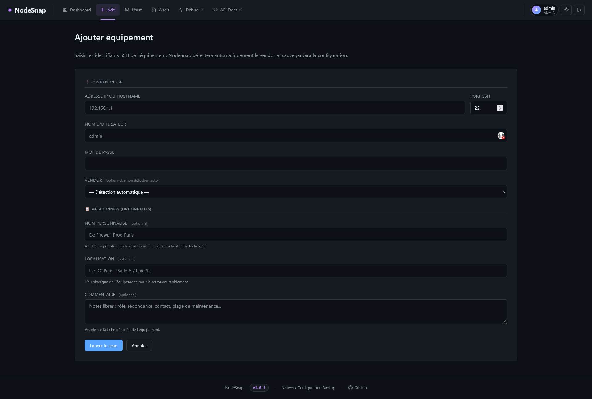</td>
<td>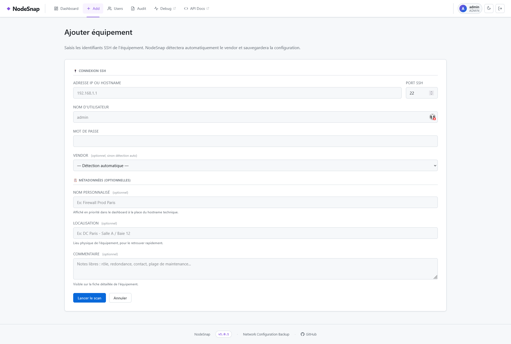</td>
</tr>
</table>

SSH scan form with automatic vendor detection, optional metadata (custom name, location, comment).

---

### Device detail & Scheduling

<table>
<tr>
<td align="center"><b>🌑 Dark</b></td>
<td align="center"><b>☀️ Light</b></td>
</tr>
<tr>
<td>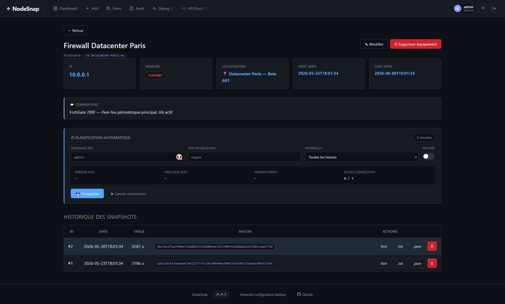</td>
<td>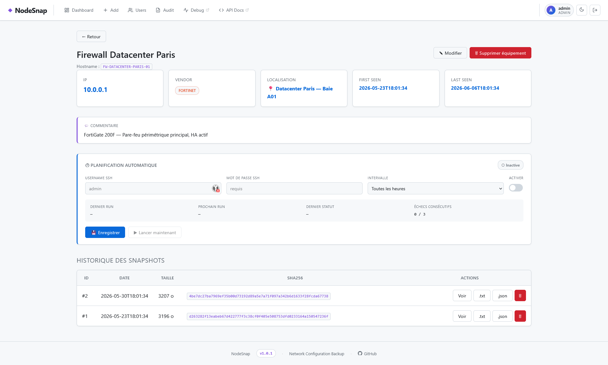</td>
</tr>
</table>

Device details: information, comment, automatic scheduling (credentials, interval, status) and snapshot history with SHA-256.

---

### Configuration viewer

<table>
<tr>
<td align="center"><b>🌑 Dark</b></td>
<td align="center"><b>☀️ Light</b></td>
</tr>
<tr>
<td>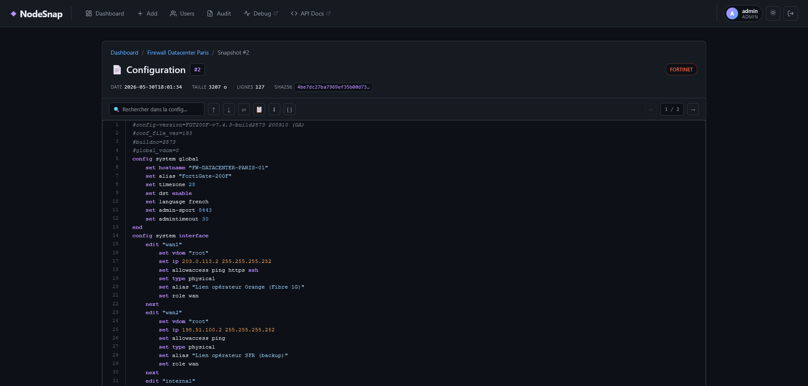</td>
<td>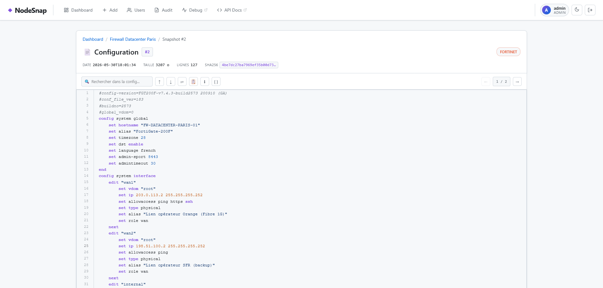</td>
</tr>
</table>

Snapshot viewer with syntax highlighting, full-text search, snapshot navigation and `.txt` / `.json` export.

---

### Audit log

<table>
<tr>
<td align="center"><b>🌑 Dark</b></td>
<td align="center"><b>☀️ Light</b></td>
</tr>
<tr>
<td>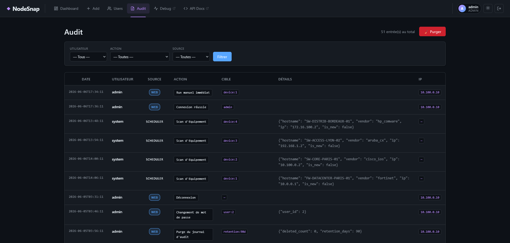</td>
<td>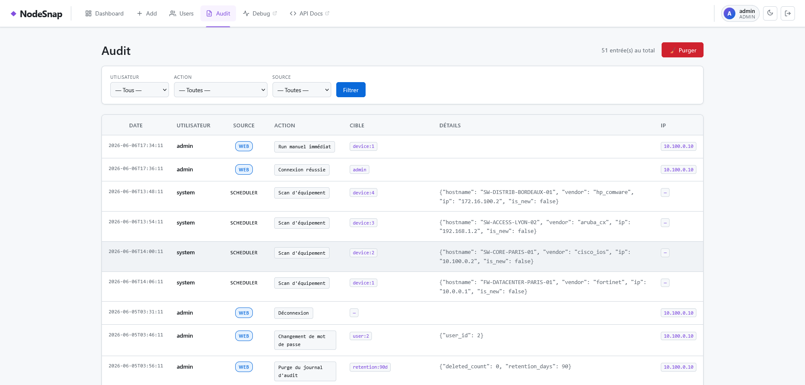</td>
</tr>
</table>

Full traceability: logins, manual and automatic scans, modifications, deletions — filterable by user, action and source (web / scheduler).

---

### User management

<table>
<tr>
<td align="center"><b>🌑 Dark</b></td>
<td align="center"><b>☀️ Light</b></td>
</tr>
<tr>
<td>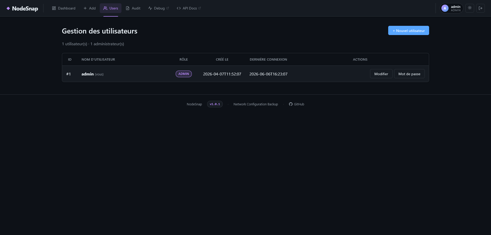</td>
<td>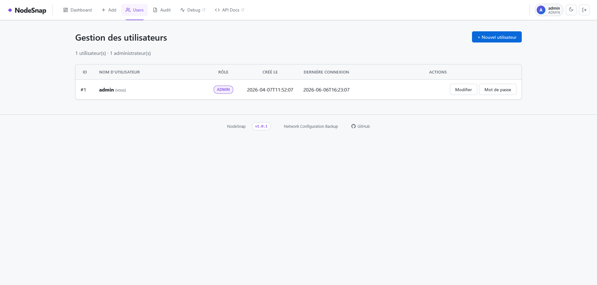</td>
</tr>
</table>

Multi-user management with admin / user roles, creation, modification and password change.

---

### API documentation

<table>
<tr>
<td align="center"><b>☀️ Light</b></td>
</tr>
<tr>
<td>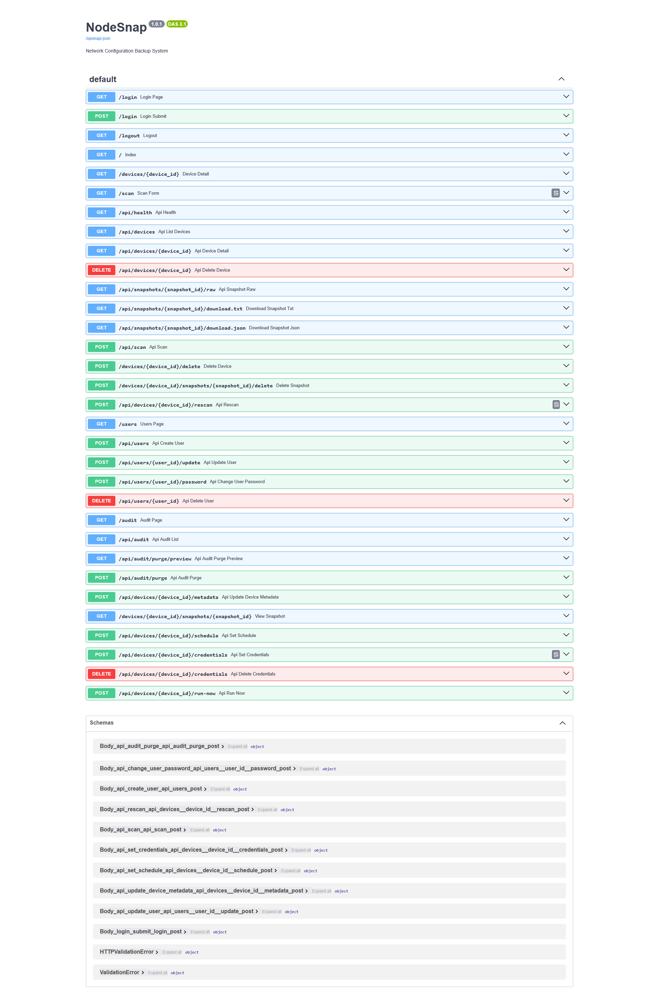</td>
</tr>
</table>

Interactive Swagger documentation available at `/api/docs` — all REST endpoints are explorable and testable directly.

---

## 🗂️ Project layout

```
NodeSnap/
├── nodesnap.py              # CLI — manual device backup
├── version.py               # Application version (source of truth)
├── requirements.txt
├── .env.example             # Configuration template (no secrets)
│
├── api/                     # Web interface & REST API (FastAPI)
│   ├── main.py              # App initialization, middlewares
│   ├── routes.py            # HTML and JSON endpoints
│   ├── i18n.py              # Internationalization module (FR / EN)
│   └── templates/           # Jinja2 templates
│       ├── base.html        # Common layout (header, footer, theme)
│       ├── index.html       # Dashboard — devices list
│       ├── device.html      # Device detail + snapshots
│       ├── snapshot_view.html
│       ├── scan.html        # Scan form
│       ├── audit.html       # Audit log
│       ├── users.html       # User management
│       └── login.html
│
├── core/
│   └── detector.py          # Automatic vendor detection over SSH
│
├── collectors/
│   └── fetcher.py           # Per-vendor configuration retrieval
│
├── storage/
│   ├── database.py          # SQLite — devices & snapshots
│   ├── credentials.py       # AES-256-GCM encrypted credentials
│   ├── users.py             # Users & authentication (bcrypt)
│   └── audit.py             # Audit log
│
├── services/
│   └── scheduler.py         # Automatic backups worker (threading)
│
├── deploy/
│   ├── install.sh           # Automated install script
│   └── nodesnap-web.service # systemd service template
│
├── i18n/                    # Translation files
│   ├── fr.json
│   └── en.json
│
├── CHANGELOG.md             # Version history
└── README.md
```

## ✨ Features

- 🔍 Automatic vendor detection over SSH (Netmiko)
- 🌐 **32 vendors supported** end-to-end (detection + backup + hostname):
  - **Cisco**: IOS, IOS-XE, IOS-XR, NX-OS, ASA, Small Business (SG/SF 200/300/350/500/550)
  - **HPE / Aruba**: Aruba CX, Aruba ProCurve, HP Comware
  - **Firewalls**: Fortinet, Palo Alto, Checkpoint, SonicWall, WatchGuard, Stormshield
  - **Juniper** (Junos), **Arista** (EOS)
  - **Dell**: OS10, OS6, Force10, PowerConnect
  - **Huawei** (VRP), **Mikrotik** (RouterOS), **Extreme** (EXOS), **Allied Telesis** (AlliedWare Plus)
  - **VyOS**, **Ubiquiti** (EdgeRouter/EdgeSwitch + UniFi Switch)
  - **Nokia SR OS** (ex-Alcatel-Lucent), **Ruckus** (FastIron/ICX)
  - **F5 BIG-IP** (tmsh), **pfSense**, **OPNsense**, **generic Linux**
- 🗄️ SQLite storage with SHA-256 deduplication
- 🖥️ Web interface (FastAPI + Jinja2): dashboard, scan, snapshot viewer
- 🎨 5 themes (Dark, Light, Dracula, Tokyo Night, Cyberpunk) with cookie persistence
- ⏱️ Automatic backup scheduler with failure handling
- 🔐 AES-256-GCM encrypted credentials
- 📋 Full audit log
- 👥 Multi-user with roles (admin = write, user = read-only)
- 🛡️ CSRF protection, login rate-limiting, security HTTP headers (CSP, X-Frame-Options…)
- 🔑 SSH host-key verification for devices (TOFU, project-level `known_hosts`) against credential interception
- 🌍 Multilingual interface (Français / English) with one-click switch

## ⚙️ Installation

```bash
python3 -m venv .venv
source .venv/bin/activate            # bash / zsh
# source .venv/bin/activate.fish     # fish shell
# source .venv/bin/activate.csh      # csh / tcsh
pip install -r requirements.txt
```

> 💡 On **fish** or **csh**, use the matching variant (`activate.fish` or `activate.csh`) — otherwise the shell will throw a parse error on `VIRTUAL_ENV=…`.

## 🔧 Configuration

```bash
cp .env.example .env
sed -i "s|SESSION_SECRET=changeme|SESSION_SECRET=$(python3 -c 'import secrets; print(secrets.token_urlsafe(48))')|" .env
```

The 2nd command generates a random `SESSION_SECRET` and injects it directly into `.env`.

Variables available in `.env`:

| Variable | Description |
|---|---|
| `SESSION_SECRET` | Web session signing key (required in production) |
| `NODESNAP_MASTER_KEY` | AES-256 key for credentials (auto-generated if missing) |
| `TRUSTED_PROXY` | Set to `1` if the app is behind a reverse proxy (enables X-Forwarded-For) |
| `HTTPS_ONLY` | Set to `1` when serving over HTTPS — marks the session cookie `Secure` |
| `NODESNAP_SSH_STRICT_HOST_KEYS` | `1` (default): each device's SSH key is learned on first scan and enforced afterwards (`./known_hosts`). `0` disables verification (not recommended) |
| `NODESNAP_SSH_LEGACY_ALGOS` | `1` (default): re-enables legacy SSH algorithms (SHA-1 KEX, AES-CBC, 3DES, ssh-dss) for old devices. `0` on a modern fleet |

> ⚠️ **Network exposure**: the service listens over plain HTTP on `0.0.0.0:8000`. Web passwords **and device SSH passwords** travel in form posts: in production, put NodeSnap behind a TLS reverse proxy (`HTTPS_ONLY=1`, `TRUSTED_PROXY=1`) or bind to `127.0.0.1`.

Host key changed after a legitimate device replacement:

```bash
python -m core.hostkeys list                  # pinned keys
python -m core.hostkeys forget 10.0.0.1 [22]  # re-learned on next scan
```

## 🚀 Usage

### Web interface

```bash
uvicorn api.main:app --host 0.0.0.0 --port 8000
```

Create the first admin user (password is prompted interactively):

```bash
python -m storage.users create <username> admin
```

### 🌍 Languages

The interface is translated to **French** and **English**. Switch in one click via the `FR` / `EN` button in the navigation bar, or from the login page. The preference is stored in a `nodesnap_lang` cookie (1-year lifetime).

To add or fix a translation, edit `i18n/fr.json` or `i18n/en.json` and restart the service (files are loaded at boot).

### 🔐 Roles

| Role | Read (dashboard, snapshots, configs) | Write (scan, delete, scheduling, users, audit) |
|---|:---:|:---:|
| `admin` | ✅ | ✅ |
| `user` | ✅ | ❌ |

### ⏱️ Automatic backups

NodeSnap ships with a background scheduler that automatically triggers backups according to a per-device interval.

**Configuration via the web interface (device detail page):**

1. Store the device SSH credentials *(Scheduling tab)*
2. Enable scheduling and set the interval in minutes
3. Optional: trigger an immediate run with the **Run now** button

**Behavior:**
- The scheduler checks for due devices every **60 seconds**
- A snapshot is only created if the configuration has **changed** since the last backup (SHA-256 deduplication)
- After **3 consecutive failures**, scheduling is automatically disabled and an audit entry is created
- Up to **5 concurrent scans** at the same time

### CLI (one-off scan)

```
Usage: ./nodesnap.py <host> <user> [password] [options]
```

| Parameter | Type | Default | Description |
|-----------|------|---------|-------------|
| `host` | positional | — | Device IP address or hostname |
| `user` | positional | — | SSH username |
| `password` | positional optional | prompt | SSH password (see methods below) |
| `--vendor` | option | auto-detect | Force device type |
| `--port` | option | `22` | SSH port |
| `--output` | option | `./backups` | Directory for `.cfg` backup files |
| `--common-name` | option | — | Display name in the UI (e.g. "Paris Prod Firewall") |
| `--location` | option | — | Physical location (e.g. "DC Paris - Rack 12") |
| `--comment` | option | — | Free-form note shown on the device page |
| `-v` / `--verbose` | flag | — | Enable DEBUG logging |

**3 ways to supply the password (by priority order):**

```bash
# 1. Interactive masked prompt (recommended — leaves nothing in shell history)
./nodesnap.py 192.168.1.1 admin

# 2. Environment variable (suited for scripts)
NODESNAP_PASSWORD='mypass' ./nodesnap.py 192.168.1.1 admin

# 3. Direct argument (not recommended — visible in shell history)
./nodesnap.py 192.168.1.1 admin mypass
```

**Examples:**

```bash
# Minimal scan — vendor auto-detected, password prompted interactively
./nodesnap.py 192.168.1.1 admin

# With a custom name (displayed on the dashboard instead of the hostname)
./nodesnap.py 192.168.1.1 admin --common-name "Core switch Lyon"

# With all metadata fields
./nodesnap.py 192.168.1.1 admin \
    --common-name "Paris Prod Firewall" \
    --location "DC Paris - Room A / Rack 12" \
    --comment "HA production FW paired with FW02. Maintenance 1st Tuesday of the month."

# Force vendor (skips the auto-detection phase)
./nodesnap.py 192.168.1.1 admin --vendor fortinet
./nodesnap.py 192.168.1.1 admin --vendor cisco_ios
./nodesnap.py 192.168.1.1 admin --vendor ubiquiti_edge

# Non-standard SSH port
./nodesnap.py 192.168.1.1 admin --port 2222

# Custom output directory for .cfg files
./nodesnap.py 192.168.1.1 admin --output /mnt/nas/backups/network

# Verbose mode (DEBUG logs — useful for diagnosing SSH issues)
./nodesnap.py 192.168.1.1 admin -v

# Scripted/automated use — all options combined
NODESNAP_PASSWORD="$SECRET" ./nodesnap.py 10.0.0.254 admin \
    --vendor paloalto --port 22 \
    --common-name "DMZ Firewall" \
    --location "Server room" \
    --output /opt/backups
```

**Supported vendors:**

```
Firewalls    : fortinet, paloalto, cisco_asa, checkpoint, sonicwall,
               watchguard, stormshield
Cisco        : cisco_ios, cisco_xe, cisco_xr, cisco_nxos, cisco_s300
HPE/Aruba    : aruba_cx, aruba_procurve, hp_comware
Others       : juniper, arista, huawei, mikrotik, extreme_exos,
               alliedtelesis, vyos, nokia_sros, ruckus
Ubiquiti     : ubiquiti_edge, ubiquiti_unifi
F5 / Linux   : f5_tmsh, linux
BSD Firewalls: pfsense, opnsense
Dell         : dell_os10, dell_os6, dell_force10, dell_powerconnect
```

> Metadata (`--common-name`, `--location`, `--comment`) is **preserved** on subsequent rescans if not passed again as arguments.

## 🖥️ Deployment (systemd service)

After cloning the repo, a single script installs everything:

```bash
sudo bash deploy/install.sh
```

The script takes care of:
- Creating the venv and installing dependencies
- Generating the `.env` file with a random `SESSION_SECRET`
- Creating the `backups/` and `logs/` folders
- Installing and starting the `nodesnap-web` systemd service
- Adding the `nodesnap-env` alias to the shell
- Creating the first admin account (interactive)

> The service restarts automatically when the server reboots.

## 🛠️ Useful commands (production)

```bash
nodesnap-env                          # Activate the Python venv

sudo systemctl status nodesnap-web    # Web service status
sudo systemctl start nodesnap-web     # Start the web service
sudo systemctl stop nodesnap-web      # Stop the web service
sudo systemctl restart nodesnap-web   # Restart the web service

journalctl -u nodesnap-web -f                  # Live logs
journalctl -u nodesnap-web -n 100 -f          # Last 100 lines + follow
journalctl -u nodesnap-web --since today -f   # Logs since today
journalctl -u nodesnap-web -p err -f          # Errors only

./nodesnap.py <ip> <user> [options]   # Manual backup (see CLI section above)
```

## 🏷️ Versioning

The current version is defined in [`version.py`](version.py) and shown in the web footer.  
See [CHANGELOG.md](CHANGELOG.md) for the version history.

To bump the version before a Git tag:

```bash
# Edit version.py, then:
git add version.py
git commit -m "bump: v1.1.0"
git tag v1.1.0
git push --follow-tags
```

> ⚠️ After each bump, restart the service so the UI reflects the new version:
> ```bash
> sudo systemctl restart nodesnap-web
> ```

## 📄 License

MIT
